<!-- ============================================================
  GitHub profile README: M. A. Ulfat | Data Analyst & Data Scientist
  Save as README.md in your repo named exactly: m-a-ulfat
  Lines marked  <!-- EDIT -->  are the ones you should personalise.
============================================================= -->

 

---

## 👋 About Me

I am a **Data Analyst and aspiring Data Scientist** who turns complex datasets into clear dashboards, reliable reports and predictive insights. I work at **Akhuwat Islamic Microfinance**, where I build Power BI dashboards, MIS reports and machine learning solutions that support operational efficiency and data-driven decisions for the **Apni Chhat Apna Ghar (ACAG)** project and many other programs.

I enjoy sitting between **analytics and AI**: cleaning messy data, finding the story in it, and then using models to predict what comes next.

<table>
<tr>
<td width="50%" valign="top">

### 🔭 Currently working on
- Interactive **Power BI** dashboards and automated MIS reporting
- **Machine Learning** models for operational and predictive analysis
- Data quality assurance and analytical reporting across multiple projects

### 🌱 Currently learning
- Advanced **Python** and **Machine Learning**
- Statistical analysis and predictive modelling
- Artificial Intelligence
- 🇩🇪 **German** (A1 level)

</td>
<td width="50%" valign="top">

### 👯 Looking to collaborate on
- Data Analytics and Business Intelligence
- Machine Learning and Predictive Analytics
- Applied AI projects that solve real-world problems

### 🤝 Looking for help with
- Advanced ML algorithms and statistical modelling
- Feature engineering and model optimisation
- Model deployment and scalable AI solutions

</td>
</tr>
</table>

> 💬 **Ask me about:** Python, SQL, Power BI, Excel, Tableau, Machine Learning, Data Preprocessing, EDA, Data Visualization, Dashboard Development, MIS Reporting and Data Quality Assurance.

---

## 🧭 How I Work

```mermaid
flowchart LR
    A[📥 Collect Data] --> B[🧹 Clean and Validate]
    B --> C[🔎 Explore - EDA]
    C --> D[🧠 Model and Predict]
    D --> E[📊 Dashboard and Report]
    E --> F[✅ Decision and Impact]
    style A fill:#203a43,color:#fff,stroke:#2E9BFF
    style B fill:#203a43,color:#fff,stroke:#2E9BFF
    style C fill:#203a43,color:#fff,stroke:#2E9BFF
    style D fill:#203a43,color:#fff,stroke:#2E9BFF
    style E fill:#203a43,color:#fff,stroke:#2E9BFF
    style F fill:#2ea44f,color:#fff,stroke:#2ea44f
```

---

## 🎯 What I Do

| 📊 Data Analyst | 🤖 Data Scientist |
|---|---|
| Interactive dashboards (Power BI, Tableau) | Machine Learning model building |
| MIS and operational reporting | Predictive analytics and forecasting |
| SQL querying and data extraction | Feature engineering and model tuning |
| Excel analysis and automation | Statistical analysis and hypothesis testing |
| Data cleaning and quality assurance | Experiment tracking with MLflow |
| Exploratory Data Analysis (EDA) | Deep learning with TensorFlow, Keras, PyTorch |

---

## 🛠️ Tech Stack

### 📊 Analytics and BI

### 🐍 Programming and Data

### 🧠 Machine Learning and AI

### 📈 Visualization

### 🗄️ Databases

➕ Other tools I have used

 

---

## 🚀 Featured Projects

<!-- EDIT: replace the placeholders below with your real repositories and results. -->

| Project | What it does | Tools |
|---|---|---|
| 📊 **[Dashboard project name](https://github.com/m-a-ulfat)** | One sentence on the problem and the result (for example: "tracks ACAG progress across regions") | `Power BI` `SQL` |
| 🤖 **[ML project name](https://github.com/m-a-ulfat)** | One sentence on the model, the data, and the accuracy or business result | `Python` `scikit-learn` |
| 🧹 **[Data cleaning / EDA project](https://github.com/m-a-ulfat)** | One sentence on the dataset and the insights you found | `Pandas` `Matplotlib` |

---

## 📊 GitHub Stats

---

## 🤝 Let's Connect

 

💡 *"Data tells a story. My job is to make sure the right people can read it."*

